<a href="https://gcarbs1.github.io/work-gallery/"></a>

I am a data analyst at **Red Bull Bragantino**, working across sports analytics, from data preparation and statistical modeling to communicating results. I hold a degree in Statistics and Data Science and am currently pursuing a master’s degree in Applied and Computational Mathematics, both at the **University of São Paulo**.

 

<picture>
  <source media="(prefers-color-scheme: dark)" srcset="assets/headings/work-dark.svg">
  
</picture>

<a href="https://gcarbs1.github.io/pacific-dataviz-challenge_26/">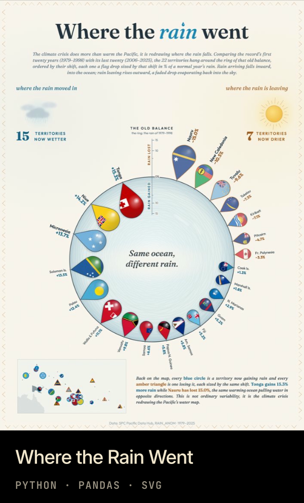</a>
<a href="https://gcarbs1.github.io/fwc-match-reports/">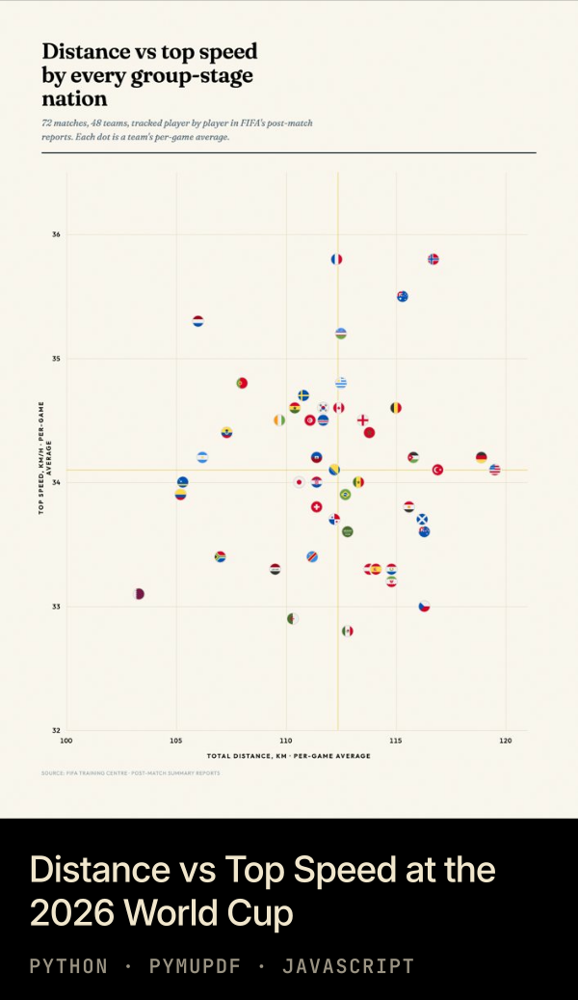</a>
<a href="https://github.com/gcarbs1/brazil-land-cover-40-years">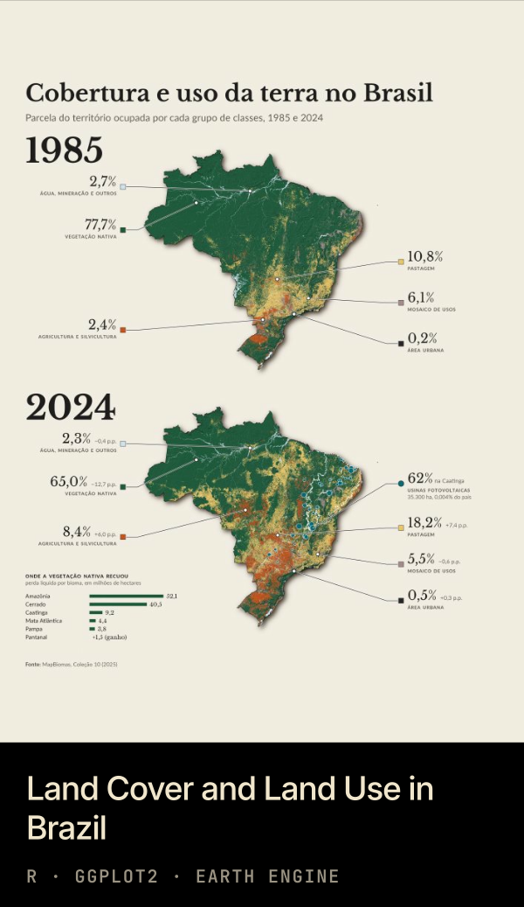</a>

<a href="https://gcarbs1.github.io/statistical-player-opportunity-monitoring/">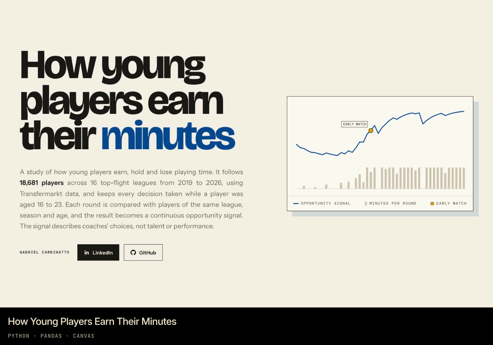</a>

<a href="https://gcarbs1.github.io/brazilian-league-2026-player-birthplaces/">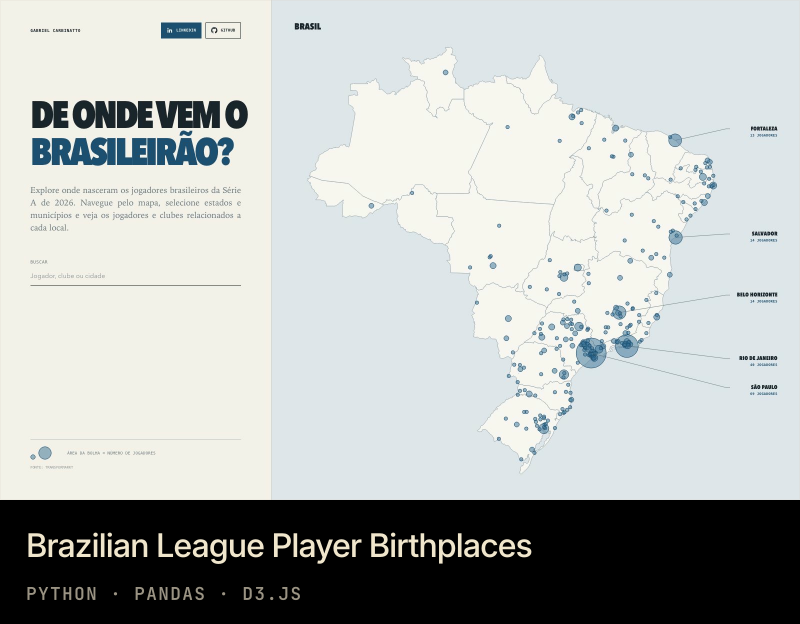</a>
<a href="https://gcarbs1.github.io/cbf-match-report-analysis/">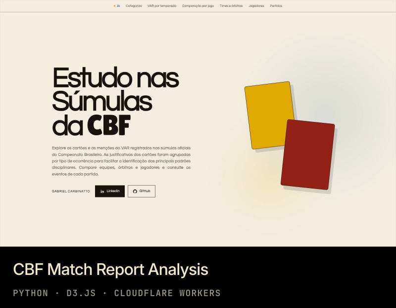</a>

<a href="https://gcarbs1.github.io/Color-Palette-Selector/">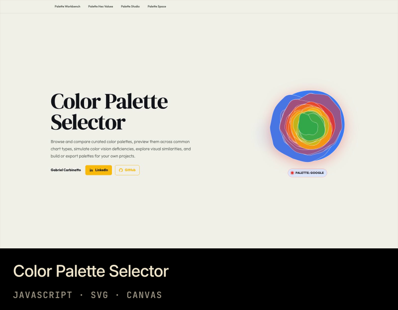</a>
<a href="https://gcarbs1.github.io/skillcorner-bodypose-viewer/">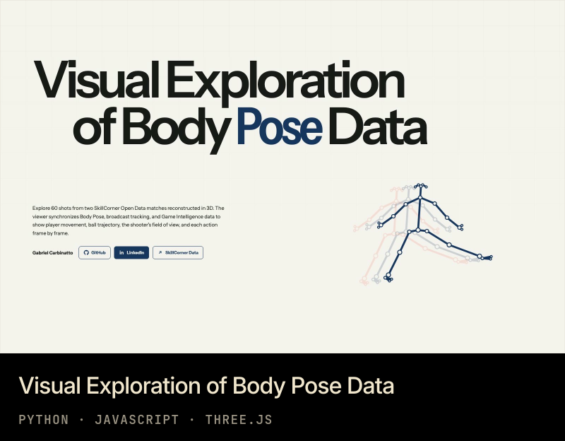</a>

<a href="https://github.com/gcarbs1/football-birthday-paradox">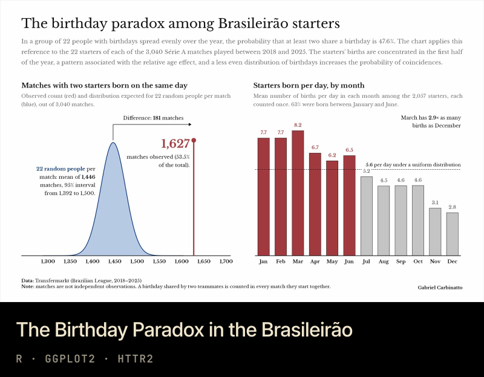</a>
<a href="https://github.com/gcarbs1/Synergy-VAEP">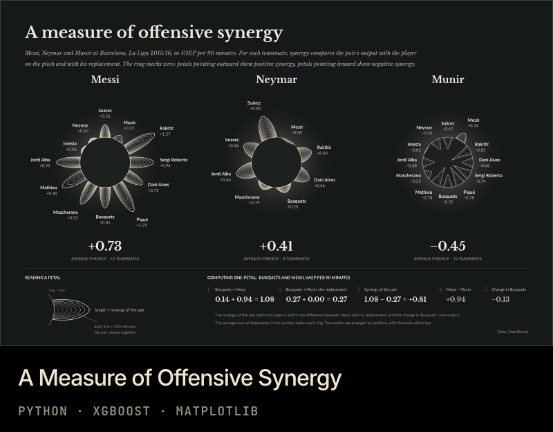</a>

 

<picture>
  <source media="(prefers-color-scheme: dark)" srcset="assets/headings/path-dark.svg">
  
</picture>


 

<picture>
  <source media="(prefers-color-scheme: dark)" srcset="assets/headings/contact-dark.svg">
  
</picture>

For projects, research or data-related conversations, use any of the links below.

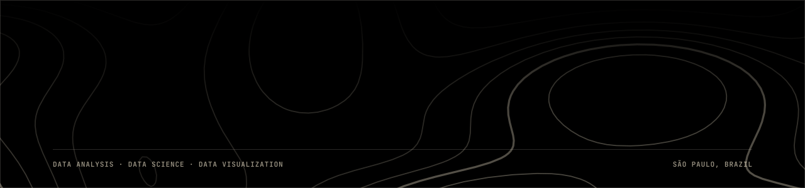

Every image on this page is generated by <a href="scripts/build.py"><code>scripts/build.py</code></a>: the relief in the header is the same contour field as the <a href="https://gcarbs1.github.io/work-gallery/">work gallery</a>, traced with marching squares and animated with CSS.
